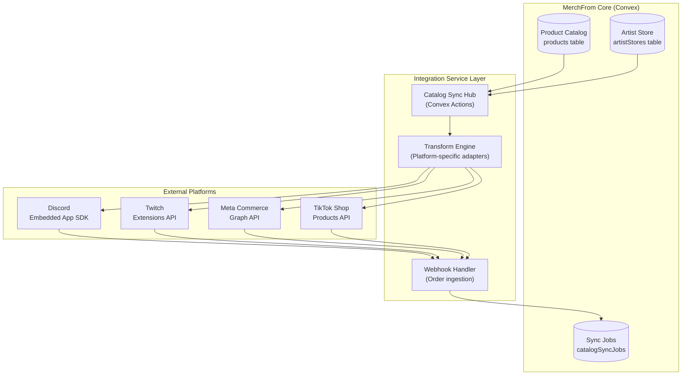
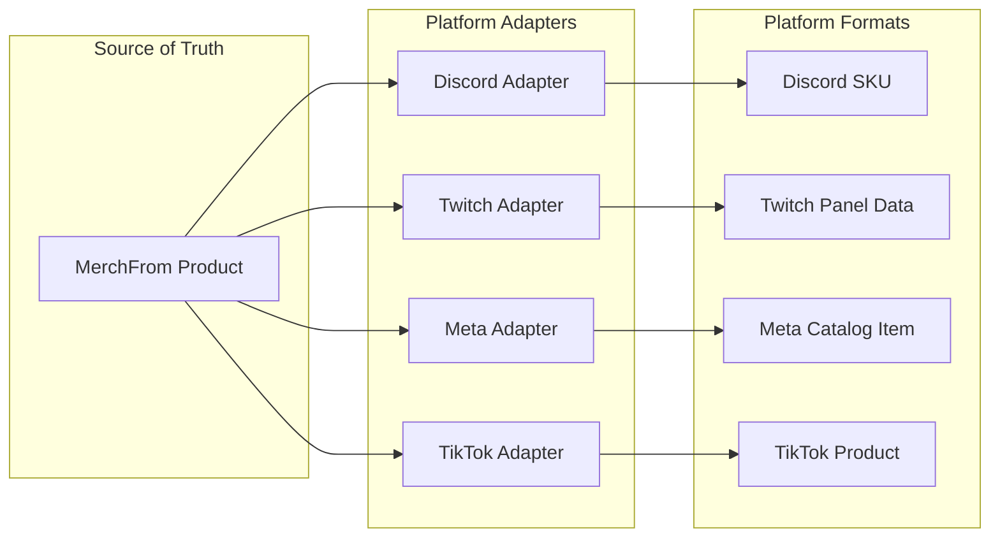
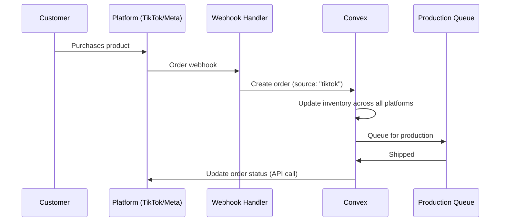

# Social Commerce Integration Hub: Architecture & Implementation Plan

> **Strategic Vision:** Transform MerchFrom into a **Social Commerce Operating System** that lets creators syndicate their product catalog to Discord, Twitch, Instagram Shop, Facebook Shop, and TikTok Shop with a few clicks from their artist dashboard.

---

## Executive Summary

This document outlines the architecture for building a **Unified Catalog Syndication Engine** that positions MerchFrom as the single source of truth for creator merchandise, automatically pushing products to 5+ social commerce platforms.

### The Opportunity
| Metric | Value |
|--------|-------|
| **Discord DAUs** | 150M+ (highly engaged gaming/creator communities) |
| **Twitch Concurrent Viewers** | 2.5M+ average (direct streamer-fan relationship) |
| **Instagram Shop Users** | 130M+ monthly product tappers |
| **TikTok Shop GMV (2024)** | $20B+ (fastest-growing commerce channel) |
| **Facebook Marketplace Users** | 1B+ monthly |

### Strategic Fit with MerchFrom
This integration extends the Cat-Suite AI paradigm:
- **Leopoldo** → Manages catalog syndication strategy across platforms
- **Francisca** → Ensures designs meet each platform's visual requirements
- **Antônia** → Handles cross-platform order routing and fulfillment sync

---

## Architecture Overview



---

## Platform-by-Platform Analysis

### 1. Discord Integration (High Priority ⭐⭐⭐)

#### Why Discord?
Discord is THE creator community hub. Unlike passive social media, Discord offers:
- **Active community engagement** (fans already gathered in servers)
- **Voice/Video commerce moments** (show drops during streams)
- **Deep gamification** (integrate with Merch Coins system)

#### Integration Approach: **Discord Activity + Bot Hybrid**

| Component | Technology | Purpose |
|-----------|-----------|---------|
| **Merch Activity** | Embedded App SDK (iframe) | Interactive storefront within Discord voice/text channels |
| **Merch Bot** | Discord.js + Slash Commands | Quick product drops, inventory checks, purchase links |
| **SKU Sync** | Discord IAP API | In-app purchases for exclusive drops |

#### Feature Set
1. **`/merch drop`** — Artist announces new product to server
2. **`/merch shop`** — Opens embedded Activity storefront
3. **`/merch leaderboard`** — Top supporters (integrates with Merch Coins)
4. **Real-time stock alerts** — Webhook-triggered notifications
5. **Cat-Suite Avatar presence** — Leopoldo greets users in Activity

#### Technical Requirements
```typescript
// Convex schema addition
export const discordIntegrations = defineTable({
  storeId: v.id("artistStores"),
  guildId: v.string(),      // Discord server ID
  channelId: v.optional(v.string()), // Default merch channel
  botToken: v.string(),     // Encrypted
  applicationId: v.string(),
  isActive: v.boolean(),
  syncConfig: v.object({
    autoAnnounce: v.boolean(),
    announcementChannel: v.optional(v.string()),
  }),
});
```

#### Revenue Considerations
- **Discord Fee:** 15% (first $1M) → 30% thereafter + 6% Stripe
- **Mandate (Oct 2024):** Must offer pricing equal to or lower than other platforms
- **Recommendation:** Use Discord for engagement/drops, redirect to MerchFrom for bulk orders

---

### 2. Twitch Integration (Medium Priority ⭐⭐)

#### Why Twitch?
Streamers sell merch during live streams. Twitch is the LIVE moment of conversion.

#### Integration Approach: **Panel Extension + Stream Overlay**

> [!CAUTION]
> **Commerce Limitation:** Twitch prohibits external payment methods in Extensions. Products can only be "exchanged" for Bits (80% to streamer, 20% to developer). This is NOT suitable for actual merchandise sales.

| Component | Technology | Purpose |
|-----------|-----------|---------|
| **Panel Extension** | Twitch Extensions API | Persistent merch showcase below stream |
| **Overlay Extension** | Twitch Extensions API | "Now Selling" pop-up during stream |
| **Bits Actions** | Bits-in-Extensions API | Gamified engagement (show appreciation, unlock previews) |

#### Recommended Strategy: **Engagement → Redirect**
Since actual purchases can't happen in Twitch, we use the Extension for:
1. **Product showcase** — Visual gallery of available merch
2. **"Get It" button** — Opens external link to MerchFrom store
3. **Bits for previews** — Spend Bits to see exclusive unreleased designs
4. **Stock countdown** — Live inventory updates during streams

#### Technical Requirements
```typescript
export const twitchIntegrations = defineTable({
  storeId: v.id("artistStores"),
  channelId: v.string(),    // Twitch channel ID
  extensionId: v.string(),  // Our Extension ID
  isAffiliateOrPartner: v.boolean(), // Required for Bits
  panelSlot: v.optional(v.number()), // 1-3
  overlayEnabled: v.boolean(),
  syncConfig: v.object({
    showcaseProducts: v.array(v.id("products")), // Curated list
    bitsPreviewEnabled: v.boolean(),
  }),
});
```

---

### 3. Meta Commerce (Instagram + Facebook Shop) (High Priority ⭐⭐⭐)

#### Why Meta?
- **Instagram:** Primary visual discovery platform for Gen Z
- **Facebook:** Massive audience, especially for 30+ demographics
- **Unified Catalog:** One API powers both platforms

#### Integration Approach: **Direct Catalog Sync via Graph API**

| Component | Technology | Purpose |
|-----------|-----------|---------|
| **Catalog Feed** | Meta Catalog API | Product data synchronization |
| **Order Sync** | Commerce Platform Webhooks | Ingest orders into MerchFrom |
| **Checkout** | On-site (Meta) or Off-site (MerchFrom) | Flexible payment handling |
| **Product Tagging** | Auto-enabled once catalog synced | Products in posts/Reels |

#### Sync Requirements (Meta Mandates)
- **Full catalog sync:** Every 24 hours minimum
- **Delta sync (price/inventory):** Every 15 minutes for high-volatility data
- **Image requirements:** Min 500x500px, no placeholders

#### Technical Requirements
```typescript
export const metaIntegrations = defineTable({
  storeId: v.id("artistStores"),
  businessManagerId: v.string(),
  catalogId: v.string(),
  pageId: v.string(),          // Facebook Page
  instagramAccountId: v.optional(v.string()),
  accessToken: v.string(),     // Long-lived, encrypted
  tokenExpiry: v.number(),
  checkoutOption: v.union(v.literal("onsite"), v.literal("offsite")),
  syncStatus: v.object({
    lastFullSync: v.number(),
    lastDeltaSync: v.number(),
    errorCount: v.number(),
  }),
});

// Scheduled job for Meta sync
export const metaCatalogSync = defineTable({
  integrationId: v.id("metaIntegrations"),
  syncType: v.union(v.literal("full"), v.literal("delta")),
  status: v.union(v.literal("pending"), v.literal("running"), v.literal("completed"), v.literal("failed")),
  productCount: v.number(),
  startedAt: v.number(),
  completedAt: v.optional(v.number()),
  errors: v.optional(v.array(v.string())),
});
```

#### Flow: Product → Meta Catalog
1. Artist adds product via Francisca (Chat) or Dashboard
2. Convex trigger queues `metaCatalogSync` job
3. `catalogSyncAction` transforms product to Meta format
4. Batch API call to Meta Graph API
5. Webhook confirms product live → Update `syncStatus`

---

### 4. TikTok Shop (High Priority ⭐⭐⭐)

#### Why TikTok?
TikTok Shop is the **fastest-growing commerce channel** globally with native in-app checkout. Creators with engaged audiences can convert directly.

#### Integration Approach: **Full Seller Catalog Sync via Partner API**

| Component | Technology | Purpose |
|-----------|-----------|---------|
| **Products API** | TikTok Shop Open API | Full CRUD for catalog |
| **Orders API** | TikTok Shop Open API | Order ingestion and status sync |
| **Affiliate API** | TikTok Shop Affiliate API | Enable creator affiliate sales |
| **Webhook Handler** | TikTok Shop Webhooks | Real-time order/status updates |

#### Requirements
- **Partner Portal registration** (US or Global)
- **OAuth 2.0 authentication** per seller
- **Rate limit:** 50 requests/second/store
- **EU Compliance (Dec 2024):** Manufacturer + Responsible Person info required

#### Technical Requirements
```typescript
export const tiktokIntegrations = defineTable({
  storeId: v.id("artistStores"),
  shopId: v.string(),          // TikTok Shop ID
  sellerId: v.string(),
  region: v.union(v.literal("US"), v.literal("UK"), v.literal("EU"), v.literal("GLOBAL")),
  accessToken: v.string(),     // Encrypted
  refreshToken: v.string(),    // Encrypted
  tokenExpiry: v.number(),
  isAffiliateEnabled: v.boolean(),
  euCompliance: v.optional(v.object({
    manufacturerId: v.string(),
    responsiblePersonId: v.string(),
  })),
  syncStatus: v.object({
    lastSync: v.number(),
    productsSynced: v.number(),
    errors: v.array(v.string()),
  }),
});
```

---

## Unified Catalog Sync Engine

### Core Concept: **Transform-Once, Push-Everywhere**

The artist's MerchFrom product becomes the "golden record." Each platform adapter transforms it to meet platform-specific requirements.



### Product Schema Extension
```typescript
// Enhanced products table
export const products = defineTable({
  // ...existing fields...
  
  // Platform-specific sync status
  platformSync: v.optional(v.object({
    discord: v.optional(v.object({
      skuId: v.string(),
      lastSync: v.number(),
      status: v.union(v.literal("synced"), v.literal("pending"), v.literal("error")),
    })),
    twitch: v.optional(v.object({
      productId: v.string(),
      lastSync: v.number(),
      status: v.union(v.literal("synced"), v.literal("pending"), v.literal("error")),
    })),
    meta: v.optional(v.object({
      productId: v.string(),
      retailerProductGroupId: v.string(),
      lastSync: v.number(),
      status: v.union(v.literal("synced"), v.literal("pending"), v.literal("error")),
    })),
    tiktok: v.optional(v.object({
      productId: v.string(),
      lastSync: v.number(),
      status: v.union(v.literal("synced"), v.literal("pending"), v.literal("error")),
    })),
  })),
  
  // Platform-specific overrides (optional)
  platformOverrides: v.optional(v.object({
    tiktok: v.optional(v.object({
      title: v.string(),  // TikTok has 255 char limit
      categoryId: v.string(),
    })),
    meta: v.optional(v.object({
      googleProductCategory: v.string(),
    })),
  })),
});
```

---

## Dashboard Integration (Artist Experience)

### UI: "Connect Channels" Panel

```
┌─────────────────────────────────────────────────────────────┐
│  🔗 CONNECT YOUR CHANNELS                                    │
├─────────────────────────────────────────────────────────────┤
│                                                              │
│  ┌──────────┐  ┌──────────┐  ┌──────────┐  ┌──────────┐    │
│  │ Discord  │  │ Twitch   │  │ Instagram│  │ TikTok   │    │
│  │   🎮     │  │   📺     │  │   📸     │  │   🎵     │    │
│  │          │  │          │  │          │  │          │    │
│  │ Connect  │  │ Connect  │  │ Connect  │  │ Connect  │    │
│  └──────────┘  └──────────┘  └──────────┘  └──────────┘    │
│                                                              │
│  Connected: 0/4 platforms                                    │
│                                                              │
└─────────────────────────────────────────────────────────────┘
```

### Connection Flow (OAuth-based)
1. Artist clicks "Connect Discord"
2. OAuth redirect to Discord Authorization
3. Callback captures tokens
4. Convex stores encrypted credentials
5. Initial catalog sync triggered
6. UI updates to "Connected ✅"

---

## Order Aggregation

Orders from all platforms flow into MerchFrom's unified order system.



---

## Roadmap & Milestones

| Phase | Timeline | Deliverables | Dependencies |
|-------|----------|--------------|--------------|
| **0: Foundation** | Week 1-2 | Catalog sync schema, platform adapter interfaces | Phase 6 (Commerce) complete |
| **1: Discord MVP** | Week 3-5 | Bot + Basic Activity, slash commands | Discord Developer Account |
| **2: Meta Catalog** | Week 6-8 | Full catalog sync, product tagging | Meta Business Manager, App Review |
| **3: TikTok Shop** | Week 9-11 | Partner registration, Products API integration | TikTok Partner Portal approval (2-3 biz days) |
| **4: Twitch Extension** | Week 12-13 | Panel Extension for product showcase | Twitch Developer Account, Extension Review |
| **5: Dashboard UX** | Week 14-15 | "Connect Channels" UI, sync status monitoring | All platform integrations |
| **6: Order Aggregation** | Week 16-17 | Unified order ingestion, cross-platform inventory sync | Webhook infrastructure |

### Deadlines (Assuming Start Date: Q1 2026)
| Milestone | Target Date |
|-----------|-------------|
| Discord Bot Live | Month 2 |
| Meta Catalog Sync | Month 3 |
| TikTok Shop Integration | Month 4 |
| Full Platform Parity | Month 5 |

---

## Considerations & Risks

### Platform-Specific Risks

| Platform | Risk | Mitigation |
|----------|------|------------|
| **Discord** | Mandatory pricing parity (Oct 2024 policy) | Offer same or lower prices as MerchFrom direct |
| **Twitch** | No direct commerce (Bits only) | Use as engagement/redirect channel, not sales |
| **Meta** | App Review delays (2-4 weeks) | Submit early, have staging environment ready |
| **TikTok** | EU compliance complexity (Dec 2024) | Build Manufacturer/RP management into dashboard |

### Technical Risks

| Risk | Impact | Mitigation |
|------|--------|------------|
| Token expiration handling | Sync failures | Implement proactive refresh logic, alert on failure |
| Rate limiting | Sync delays | Implement exponential backoff, prioritize delta syncs |
| Webhook reliability | Missed orders | Implement idempotency keys, polling fallback |
| Platform API changes | Breaking changes | Version adapters, monitor changelogs, graceful degradation |

### Business Considerations

> [!IMPORTANT]
> **MerchFrom Pricing Model:**  
> MerchFrom charges a **fixed base cost per product type**, NOT a percentage.
>
> | Product Type | MerchFrom Base Cost |
> |--------------|---------------------|
> | T-Shirts | €15 |
> | Hoodies (Basic) | €25+ |
> | Premium Items | Varies |
>
> **How Artist Revenue Works:**
> 1. Artist sets their own retail price (e.g., €35 for a tee)
> 2. Artist net = Retail Price - MerchFrom Base Cost (€35 - €15 = **€20**)
> 3. MerchFrom base cost is NEVER affected by platform fees
>
> **Platform Fee Impact:**
> | Platform | Fee | Who Pays? |
> |----------|-----|-----------|
> | MerchFrom Direct | 0% | N/A - Artist keeps full spread |
> | Discord (IAP) | 15-30% + Stripe | Deducted from Artist Net |
> | TikTok Shop | ~5% + payment | Deducted from Artist Net |
> | Meta Checkout | ~5% (varies) | Deducted from Artist Net |
>
> **Example: €35 Tee on TikTok Shop (5% fee)**
> - Retail: €35 | Base: €15 | Platform Fee: €1.75
> - Artist Net: €35 - €15 - €1.75 = **€18.25**

**Strategy:** Always prefer **off-site checkout** (redirect to MerchFrom e-shop) where platform fees are zero —maximizing artist margins.

---

## Proposed Changes Summary

### [NEW] Convex Schema Files
- `convex/schema/integrations/discord.ts` — Discord integration data
- `convex/schema/integrations/twitch.ts` — Twitch integration data  
- `convex/schema/integrations/meta.ts` — Meta (Facebook/Instagram) integration data
- `convex/schema/integrations/tiktok.ts` — TikTok Shop integration data
- `convex/schema/catalogSync.ts` — Sync job tracking

### [NEW] Convex Actions
- `convex/actions/catalog/syncToDiscord.ts`
- `convex/actions/catalog/syncToMeta.ts`
- `convex/actions/catalog/syncToTikTok.ts`
- `convex/actions/webhooks/handleMetaOrder.ts`
- `convex/actions/webhooks/handleTikTokOrder.ts`

### [MODIFY] Existing Schema
- `convex/schema.ts` — Add `platformSync` and `platformOverrides` to products

### [NEW] Dashboard Components
- `src/app/dashboard/integrations/page.tsx` — Channel connection UI
- `src/components/integrations/PlatformCard.tsx` — Individual platform tile
- `src/components/integrations/SyncStatus.tsx` — Real-time sync monitoring

### [NEW] External SDKs to Install
```bash
bun add discord.js @discordjs/rest discord-api-types
bun add twitch-api # For Extension backend
# Meta: Uses fetch/Graph API directly
# TikTok: Uses fetch with OAuth
```

---

## Verification Plan

### Automated Tests
Since this is primarily integration/infrastructure work, tests will focus on:

1. **Unit Tests: Platform Adapters**
   - Test product transformation to each platform format
   - Mock API responses for success/failure scenarios
   - Run: `bun test src/lib/adapters/`

2. **Integration Tests: OAuth Flows**
   - Test token refresh logic
   - Test webhook signature verification
   - Run: `bun test convex/actions/` (Convex test runner)

### Manual Verification

| Test | Steps | Expected Outcome |
|------|-------|------------------|
| **Discord Bot Install** | 1. Create test Discord server<br/>2. Install bot via OAuth<br/>3. Run `/merch shop` | Activity launches, products display |
| **Meta Catalog Sync** | 1. Connect test Business Manager<br/>2. Trigger sync<br/>3. Check Commerce Manager | Products appear in catalog |
| **TikTok Product Creation** | 1. Connect sandbox TikTok Shop<br/>2. Create product in MerchFrom<br/>3. Check TikTok Seller Center | Product listed correctly |
| **Order Ingestion** | 1. Place test order on TikTok/Meta<br/>2. Monitor webhook logs<br/>3. Check orders table | Order created with correct source |

---

## User Review Required

> [!IMPORTANT]
> **Before proceeding, please confirm:**
> 1. Does this architecture align with your vision for MerchFrom's multi-platform presence?
> 2. Do you want to prioritize any specific platform for Phase 1?
> 3. Should we explore "on-site" vs "off-site" checkout defaults for each platform?
> 4. Is the proposed timeline (5 months to full parity) acceptable given current MVP status?

> [!WARNING]
> **Post-MVP Dependency:** This feature set requires Phase 6 (Commerce) and Phase 7 (Launch) to be complete before implementation can begin. This is roadmapped for **Q1 2026+**.
